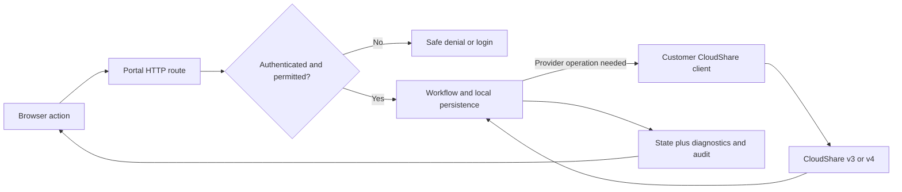

# Portal flow guide

**Fresh VM: manual initialization is required before first sign-in.** On Windows,
right-click the desktop **Initialize-Portal.cmd** file and choose **Run as administrator**.
On Ubuntu, run `/home/sysadmin/initialize-portal.sh` as `sysadmin`. This launcher creates
the private configuration, database and admin credentials, then starts the existing app.
Its deployed file removes itself only after initialization and service start succeed.
See [the Quick Start](../quick-start.md) for initialization and sign-in instructions.
If the VM is already initialized, skip setup and use the sign-in guide below.

**[Quick start: sign in as an administrator](../quick-start.md)** — find the
correct VM's Helios Certification or Certalis Sales login before exploring the flows.

Choose an action to see what the browser asks Certalis to do, what Certalis persists, and which CloudShare calls follow. Start with the [Sales Trial walkthrough](sales-trial.md). This guide describes the implemented portal at source commit **`0d5794a20532735d8d0f80bffb533ae541c7b4a9`** (2026-10-30), not an MVP roadmap.

| Persona / question | Read next |
|---|---|
| Sales Trial participant: register, choose, launch, revisit, use RDP | [Sales Trial](sales-trial.md) |
| Certalis Sales Admin: Accounts, Contacts, Opportunities, Items and defaults | [Sales configuration and records](sales-configuration.md) |
| Certalis Sales Admin: create, verify, cancel; add/invite/extend participants | [Sales sessions](sales-sessions.md) |
| Certalis Sales Admin: publish, close or end a Trial Offering | [Trial Offering administration](trial-administration.md) |
| Customer admin: connect CloudShare, author Exams, administer Candidates/cohorts | [Certification administration](certification-admin.md) |
| Candidate: schedule/join, enter, run, suspend, finish, see results | [Certification Candidate](certification-candidate.md) |
| Everyone: identity, workspace, session expiry | [Authentication](authentication.md) |
| Support: find an operation, understand polling/webhooks/background work | [Operations and diagnostics](operations.md) |
| Engineer: locate any HTTP route or provider operation | [Endpoint index](endpoints.md) |
| Reviewer / maintainer: coverage, evidence and update rules | [Coverage and verification](coverage.md) |

Certalis is the Provider portal. Helios CX is the Certification Customer; the Sales workspace has its own Customer scope. A Candidate, a Sales Trial participant and a Sales session participant are different identities and lifecycles. A Sales launch capability is not a Candidate session. CloudShare is the only live integration: Accounts, Contacts and Opportunities are local demonstration records, not a CRM integration.

**How to read a trace.** Tables are ordered within each action; conditional rows say when they run. `v4 /sales/{id}` means the path under the configured v4 API base, not a Portal URL. v3 paths are under the configured Classic v3 base. The [provider index](endpoints.md#cloudshare-operations) defines shared calls and contracts. Any v4 call can first acquire/reuse a Customer-scoped OAuth token (`POST /oauth/token`); this conditional prerequisite is factored out of each diagram. Browser page rendering may supply initial data through server composition instead of issuing the corresponding JSON GET again.

Examples use placeholders such as `{offeringId}` and `person@example.invalid`. Never paste a real launch capability, sponsored login URL, API key or protected diagnostic payload into documentation. Diagrams describe code and contract evidence, **not a claim that every branch has been exercised live**. The [verification record](coverage.md#evidence-and-maintenance) explains this boundary.
