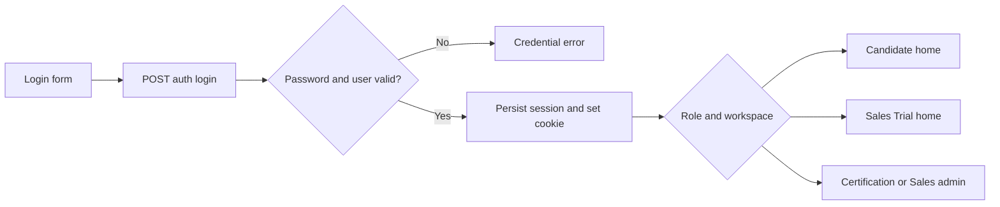

# Authentication and workspace routing

[Guide](README.md) · [Sales Trial](sales-trial.md) · [Candidate](certification-candidate.md) · [Support](operations.md)

`/login` is the common sign-in page. Certification self-registration uses `/register`; Sales Trial self-registration uses `/sales-trial/register`. Admins use configured accounts; these public forms do not grant administrative access.

| Order / action | Portal operation | Local state, permission and outcome |
|---|---|---|
| Register Candidate | `POST /api/candidate/register` | Validate profile/password and resolve the configured Certification registration Customer; create Candidate and password hash. No CloudShare operation. Duplicate/invalid registration is rejected. |
| Register Trial participant | `POST /api/sales-trial/register` | Separate Sales Customer and `sales_trial_participant` role; see the [worked example](sales-trial.md). No provider participant yet. |
| Sign in | `POST /api/auth/login` or Trial-only `POST /api/sales-trial/login` | Verify stored password, save server session, issue cookie. Shared login returns role/workspace for routing; Trial-only login restricts both role and Sales registration Customer. |
| Resolve identity | `GET /api/auth/session` | Local cookie/session lookup, including expiry; returns safe identity and expiration, never CloudShare Connection secrets. Protected server pages also resolve session directly. |
| Route | Local browser/server navigation | Candidate → `/candidate`; Trial participant → `/sales-trial`; Sales admin → `/sales`; other admin → `/admin`. Validated return targets preserve the intended allowed route. A return URL is not authorization. |
| Sign out | `POST /api/auth/logout` | Candidate logout first runs active-attempt suspension handling, then destroys the session and clears cookie. Admin/Trial logout has no corresponding environment teardown. Candidate suspension can call CloudShare as in [runtime](certification-candidate.md#runtime-clock-suspend-and-completion). |

Protected routes recompute ownership from the session. Admin routes require role `admin`; Sales routes additionally inspect Sales workspace. Some shared resource/Item routes accept `sales` or `both`, while Sales session routes use their own narrower guard: do not interpret a workspace label as permission to every route. Candidate attempt routes verify Candidate identity and Customer ownership, then lifecycle entitlement. Sales launch tokens use a separate capability flow, described in [sessions](sales-sessions.md#launch-links).

The browser session watchdog uses `GET /api/auth/session`; expiry disables protected interaction and redirects to sign in. A page that was loaded before expiry is not an authority cache. Failed credentials remain generic. Failed logout stays visible and must not be presented as success; Candidate runtime suspension failures are captured for support.

Support can search login/logout/registration audit and diagnostic operations by user and UTC time within the Customer. An audit record answers who attempted the action; CloudShare exchanges appear only for the conditional Candidate runtime work. Do not send a cookie or password as a support reference.

Sources: [auth HTTP handlers](../../src/api/portal-auth.ts), [session lookup/routing](../../src/auth/portal-session.ts), [session/password auth](../../src/auth/portal-auth.ts), [registration](../../src/auth/portal-registration.ts), [return-target validation](../../src/auth/portal-return-target.ts), [logout runtime](../../src/api/portal-logout-runtime.ts), [browser watchdog](../../src/web/session-expiry.ts).
