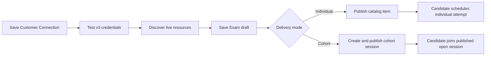
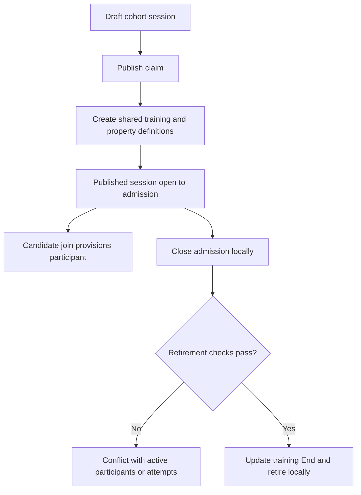

# Certification administration

[Guide](README.md) · [Candidate flow](certification-candidate.md) · [Shared discovery](sales-configuration.md) · [Monitoring and Support](operations.md)

A Customer admin uses `/admin` for Connection, catalog, Candidates, cohort sessions, monitoring and Support. The portal session determines Customer scope; a resource ID submitted by the browser is not proof of ownership.

## Connection and resource controls

| Order | Portal action | Provider work and persistence |
|---|---|---|
| 1 | `GET /api/admin/cloudshare` | Local safe Connection projection; credentials are not returned in ordinary configuration responses. |
| 2 | `PUT /api/admin/cloudshare` | Validate/save Customer credentials encrypted at rest, preserve/update optional configuration as requested, invalidate authoring cache. Local only. |
| 3 | `POST /api/admin/cloudshare/test` | v3 `GET /ping` using exact `cs_sha1` signing; record verification time on success. This does **not** prove every v4 permission or provisioning capability. |
| 4 | `POST /api/admin/sync-resources` | v4 `GET /projects` all pages; v3 `GET /regions`; per Project v3 `GET /projects/{id}/blueprints` and v4 `GET /projects/{id}/policies`. Persist resource inventory and diagnostic evidence. Partial failures are explicit. |
| 5 | `GET /api/admin/exam-authoring` | Cached bootstrap or refreshed v4 Project pages then v3 Regions; `refresh=true` requests current data. |
| 6 | `GET /api/admin/exam-authoring/projects/{projectId}` | Cached or live v3 Blueprint list, v4 Policy list and Policy details. Policies expose runtime/storage lease evidence. |
| 7 | `GET /api/admin/exam-authoring/projects/{projectId}/blueprints/{blueprintId}` | Cached or live v3 Blueprint detail; controls show default Snapshot and its deployable Regions. |

v4 calls conditionally acquire `POST /oauth/token`; v3 uses API ID/key with timestamp, a ten-character alphanumeric nonce and SHA1 HMAC. The client is per Customer. A ping success followed by OAuth/resource failure is diagnosable as a different integration surface, not contradictory evidence.

## Exam authoring and lifecycle

| Action order | Portal call | State / conditions / downstream calls |
|---|---|---|
| Browse | `GET /api/admin/exams` | Local catalog and lifecycle metadata. |
| Save draft / edit | `POST /api/admin/exams`, `PATCH /api/admin/exams/{examId}` | Validate authored fields and provisioning tuple against the Customer authoring cache; persist Exam. Missing cached resources require refresh/reselection; saving the draft itself makes no CloudShare call. No training creation. Project, Blueprint/default Snapshot, allowed Regions and Policy identify the lab; title/description/open period and delivery settings belong to the catalog. |
| Publish individual Exam | `POST /api/admin/exams/{examId}/publish` | Re-read v3 `/projects/{projectId}/blueprints/{blueprintId}` to verify current default Snapshot/Region deployment, then publish locally. A changed default Snapshot blocks publication until refreshed/reselected. |
| Unpublish | `POST /api/admin/exams/{examId}/unpublish` | Local catalog admission change. Does not destroy existing attempts or provider environments. |
| Archive | `POST /api/admin/exams/{examId}/archive` | Local historical catalog state. Active/scheduled attempts require the explicit confirmation branch; cohort Exams require all sessions retired first. No blanket provider delete. |

`runtimeLeaseMinutes` from Policy feeds `Exam.timeLimitMinutes`. Authored `openPeriodMinutes` sets the Experience End relative to scheduled start; Policy `storageLeaseMinutes` is validation/retention evidence, not the Experience duration. A published individual Exam is only a catalog item: [scheduling](certification-candidate.md#schedule-an-individual-exam) creates the training.

## Candidates

`GET /api/admin/candidates` reads a local Customer roster with search/pagination, attempt summaries and selected diagnostic context. `GET /api/admin/candidates/{candidateId}` reads owned Candidate detail/history. `POST /api/admin/candidates` creates an account through the registration handler with the admin's Customer; no CloudShare participant is created. The public [Candidate registration](authentication.md) path is separate. Roster reads do not implicitly schedule an Exam, send an invitation or reset a password; no such additional mutation endpoint is implemented here.

## Cohort session configuration and admission

Let `C = /api/admin/exams/{examId}/cohort-sessions`.

| Order / action | Portal call | Exact downstream sequence and result |
|---|---|---|
| List/create | `GET C`; `POST C` | Local owned Exam/session list; validate cohort delivery and configuration; save draft. No provider creation. |
| Detail | `GET C/{sessionId}` | Read local Exam/session/attempt context, then v4 `GET /trainings/{id}/students` and conditional `GET /guided-journey/progress/{experienceId}` for aggregate cohort monitoring. Persist monitoring observations; unavailable progress remains explicit. |
| Publish | `POST C/{sessionId}/publish` | Verify draft/Customer/Connection/default Snapshot, claim publishing; v3 `GET /teams` scoped by Project chooses required team; v4 `POST /trainings` creates on-demand shared Experience; GET and conditional POST `/trainings/{id}/users/properties` ensure Certalis keys. Persist training/Experience IDs and published session, publishing parent Exam locally if needed. |
| Join | Candidate `POST /api/candidate/exams/cohort-sessions/join` | Separate [Candidate admission](certification-candidate.md#join-a-cohort-session); creates participant in existing training, not another training. |
| Close admission | `POST C/{sessionId}/close-admission` | Local closure to new joins. Existing participants are not automatically removed. |
| Retire | `POST C/{sessionId}/retire` | Read v4 `/trainings/{id}/students` and local attempts; reject unsafe retirement when lifecycle guards fail. GET `/trainings/{id}`, PUT same path with retirement End, conditional GET confirmation; mark session retired only through the retirement workflow. |

Unknown publish outcome or property/local persistence failure after training creation becomes `publish_reconciliation_required`; another publish is blocked with correlation evidence. Ordinary retry of a pre-dispatch failure is distinct from replaying an ambiguous create. Retiring a session and archiving its parent Exam are separate actions.

For support use `/admin` Support and Monitoring, filter Exam/session/attempt identifiers and UTC action time. Resource errors expose attempted operation/surface/status; publish failures retain known training ID and completed steps. A Candidate admission complaint may be a local publication/window guard, remote start time, changed default Snapshot, or a partial participant write. Follow the [Candidate trace](certification-candidate.md) instead of assuming publication alone made entry available.

Sources: [Connection](../../src/api/admin-cloudshare.ts), [sync](../../src/api/admin.ts), [authoring](../../src/api/admin-exam-authoring-runtime.ts), [draft](../../src/api/admin-exam-draft-runtime.ts), [publish](../../src/api/admin-exam-publish-runtime.ts), [archive](../../src/api/admin-exam-archive-runtime.ts), [Candidates](../../src/api/admin-candidates.ts), [cohort publication](../../src/api/admin-cohort-exam-sessions.ts), [cohort lifecycle](../../src/api/admin-cohort-exam-session-lifecycle.ts), [training delivery](../../src/integrations/cloudshare/training-delivery.ts), [retirement adapter](../../src/integrations/cloudshare/cohort-experience-retirement.ts), [ADR-005](../decisions/ADR-005-exam-time-limit-open-period-and-storage-lease.md).
