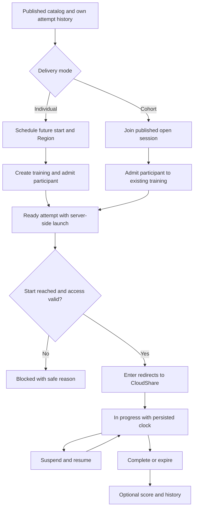
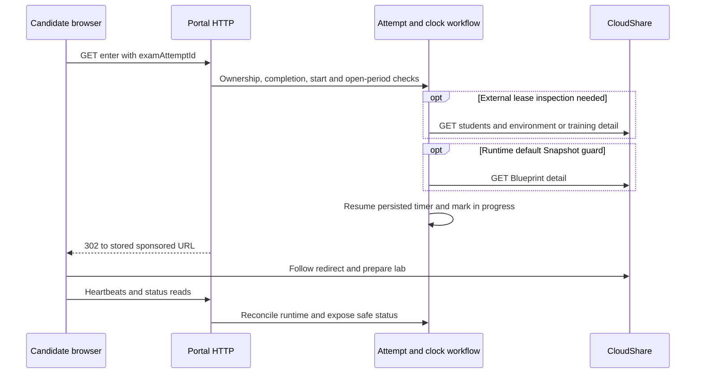

# Certification Candidate: admission, lab and results

[Guide](README.md) · [Admin setup](certification-admin.md) · [Authentication](authentication.md) · [Support](operations.md)

After registration/login the Candidate opens `/candidate`, chooses an individual Exam or a cohort session, then uses `/candidate/lab?examAttemptId={id}` and `/candidate/score?examAttemptId={id}`. Every mutation rechecks session ownership and lifecycle entitlement; browser countdowns and disabled buttons are guidance, not authorization.

## Browse and determine availability

`GET /api/candidate/exams` assembles the Customer's published catalog and this Candidate's attempts/session options through the dashboard runtime. Existing attempt completion/external-lease reconciliation can run while deriving availability. It is not always a passive SQL-only read: a runtime/lease inspection can use training participants, v4 environment detail or training detail as described below. History comes from owned persisted attempts; it does not enumerate another Candidate's provider environments.

Individual scheduling requires a published individual Exam, connected Customer, future valid start, permitted Region and no conflicting active admission. Cohort joining requires the published cohort/session, admission still open, eligible timing and no conflicting attempt. A changed Blueprint default Snapshot or invalid Region blocks both even if the card was previously available.

## Schedule an individual Exam

| Order | Call / local action | Inputs, output and state |
|---|---|---|
| 1 | Browser `POST /api/candidate/exams` | Exam ID, chosen Region and `scheduledFor`; validate current published Exam, future timestamp, Customer Connection and admission conflicts. |
| 2 | v3 `GET /projects/{projectId}/blueprints/{blueprintId}` | Runtime default-Snapshot/Region guard; failure returns safe Candidate error with internal resource evidence. |
| 3 | Local reserve ExamAttempt | Allocate attempt identity before remote admission to prevent conflicting parallel requests. |
| 4 | v3 `GET /teams` with Project lookup query | Resolve required team for the training, using stored Exam/Customer configuration. |
| 5 | v4 `POST /trainings` | Individual Experience from Project/Blueprint/Region/Policy; scheduled Start and authored open-period End. Persisted evidence retains training ID even if a later step fails. |
| 6 | v4 `GET /trainings/{id}/users/properties`; conditional `POST` same | Ensure Certalis correlation definitions used by participant admission. |
| 7 | v4 `POST /trainings/{id}/students` | Candidate identity plus attempt correlation properties. This is admission, not proof of an assigned running environment. |
| 8 | v4 `POST /trainings/{id}/sponsored-link` | Obtain login URL. Persist `LabLaunch` server-side with training/Experience ID and participant identity; mark attempt `ready`; return safe scheduling result. |

The training and sponsored link are created **during scheduling**, before `/enter`. No speculative `/experiences` call belongs in this active training flow, even though compatibility adapter methods remain in source. Partial provisioning errors record the last successful step; a failed response is not proof that no training/student was created.

## Join a cohort session

`POST /api/candidate/exams/cohort-sessions/join` takes Exam/session identity and chosen Region. Ordered work: validate published owned session/admission and candidate conflicts; reserve attempt; recheck default Snapshot; v4 `GET /trainings/{id}` reads provider Start; if not started, release/recover local admission and deny; otherwise GET/conditional POST `/trainings/{id}/users/properties`, POST `/trainings/{id}/students`, POST `/trainings/{id}/sponsored-link`; persist the ready attempt and server-side launch. No new training is created on join. The [admin publication flow](certification-admin.md#cohort-session-configuration-and-admission) created that shared training earlier.

## Enter and discover the environment

`GET /enter?examAttemptId={id}` requires an owned attempt in `ready` or `in_progress`, scheduled start reached, an existing `LabLaunch`, valid authored open period and authoritative external lease where available. Expired/completed/suspended/unknown-correlated states are rejected appropriately; resume is a separate action. The handler resumes the persisted clock and changes `ready` to `in_progress` before issuing 302. The stored sponsored URL is never returned in the normal catalog/status JSON.

Provider assignment can lag entry. v4 `GET /trainings/{trainingId}/students` resolves the Candidate's participant and environment mapping; subsequent runtime observation uses v4 `GET /environments/{environmentId}`. The mapping is persisted on `LabLaunch`; callers require a verified actionable identity before commands. The environment `envId` metadata in a different provider surface is not interchangeable with the opaque canonical ID. Missing/unready mapping produces a preparing or blocked operation, not a guessed command target.

External lease checks use the mapped environment when available and training detail where appropriate. Provider expiry can mark an attempt expired independently of the remaining Portal clock. Opening a lab cannot extend the authored open period or provider lease.

## Runtime clock, suspend and completion

| Action / order | Portal request | Internal/provider behavior |
|---|---|---|
| Status | `GET /api/exam/status?examAttemptId={id}` | Ownership, completion reconciliation, then safe attempt/clock state. Conditional runtime settlement can inspect provider environment and capture completion evidence; it is not a raw provider proxy. |
| Heartbeat | `POST /api/heartbeat` with attempt ID | Candidate launcher sends every 15 seconds while lab lifecycle permits. Refresh tracking; reconcile completion; suspended returns suspended, non-running attempts conflict. It does not create a training or renew the CloudShare lease. |
| Suspend | `POST /api/exam/suspend` with attempt ID | Settle completion; resolve student/environment correlation; durable runtime-command guard; observe environment, v4 `POST /environments/{id}/suspend` if needed, poll v4 GET detail until observed target/bounded failure; settle persisted timer and attempt only through the lifecycle workflow. |
| Resume | `POST /api/exam/resume` with attempt ID | Settle completion; require suspended/reconcilable command, valid open period and external lease; correlate and observe; v4 `POST /environments/{id}/resume` if needed; observe confirmation; resume clock. Already active recovery can settle from observation rather than dispatch another command. |
| End exam early | `POST /api/exam/complete` with attempt ID | For running/suspended attempts, verify correlation; v3 `PUT /envs/actions/archive?envId={id}` if not already archived; observe confirmation; persist completion. Archive is not DELETE. A provider-success/local-save failure explicitly says the lab is archived but completion still needs saving. |
| Automatic completion | Status, heartbeat and other lifecycle reconciliation | Persisted elapsed time/open-period/lease evidence drives completion/expiry; completion settlement and score capture can occur without a separate button click. Do not infer a provider write from every timer display update. |
| Client runtime report | `POST /api/candidate/runtime-diagnostics` | Owned, constrained browser-event diagnostics. Local evidence only; not permission to submit arbitrary protected provider payloads. |

The launcher checks its child window every three seconds. The lab shell refreshes status every 15 seconds; the Candidate home refresh interval is 30 seconds. Timer state is persisted server-side rather than reset by browser reload. Automatic missing-heartbeat suspension runs through the same correlated suspend workflow when background jobs are enabled; [operations](operations.md#automatic-work-and-request-triggered-work) explains its limits.

Provider command acknowledgements are not completion. Timeouts, rate limits, preparation states and unconfirmed writes remain diagnostic/reconcilable outcomes; the workflow's durable command state prevents blind repeated writes. Follow the safe UI action/result and examine support evidence before retrying an uncertain operation.

## Score and history

`GET /api/exam/score?examAttemptId={id}` is available after completion or the Exam open period closes. If score retrieval is disabled, return explicit no-score metadata without a Guided Journey call. Otherwise resolve the launch participant via training roster as needed and call v4 `GET /guided-journey/progress/{experienceId}/{participantId}`; the adapter also supports aggregate `GET /guided-journey/progress/{experienceId}` for diagnostic/aggregate use. Compute/persist score result from provider progress evidence and return availability/retrieval time. Missing/unavailable progress is not an invented zero score. Completed score capture can be triggered by lifecycle settlement as well as the score page.

History reflects stored attempts/results. A score retrieval failure is distinct from an unsuccessful Exam attempt and is logged with operation, surface and correlation. Admins use attempt detail and Support to distinguish disabled scoring, absent participant mapping, no available progress, provider failure and persisted result.

Diagnostic walkthrough: collect `examAttemptId`, UTC time and safe correlation ID from the error. In `/admin` Monitoring open that attempt, compare status, timer, launch mapping and external lease evidence; then open Support/attempt diagnostics and follow `exam_attempt.*`, `cloudshare.*` operations to ordered HTTP exchanges. Check scheduling step boundaries before retrying admission, and command dispatch/readback boundaries before retrying suspend/resume/end.

Sources: [dashboard](../../src/api/exam-attempt-dashboard-runtime.ts), [schedule](../../src/api/exam-attempt-scheduling-runtime.ts), [scheduling domain](../../src/domain/scheduling.ts), [cohort join](../../src/api/cohort-exam-session-join-runtime.ts), [entry](../../src/api/exam-attempt-runtime.ts), [environment correlation](../../src/api/exam-attempt-environment-correlation.ts), [status/heartbeat](../../src/api/exam-attempt-heartbeat-status-runtime.ts), [runtime commands](../../src/api/exam-attempt-suspend-resume-runtime.ts), [early completion](../../src/api/exam-attempt-early-completion-runtime.ts), [score](../../src/api/exam-attempt-score-runtime.ts), [clock](../../src/domain/exam-clock.ts), [ADR-002](../decisions/ADR-002-server-side-sponsored-link-redirect.md), [ADR-005](../decisions/ADR-005-exam-time-limit-open-period-and-storage-lease.md).

Provider-contract caveat: implemented v3 `GET /users` (Project member discovery) and `PUT /envs/actions/archive` are absent from the bundled v3 export. See the [endpoint discrepancy record](endpoints.md#contract-and-implementation-discrepancies) and historical gap evidence; this guide does not claim new live verification.
