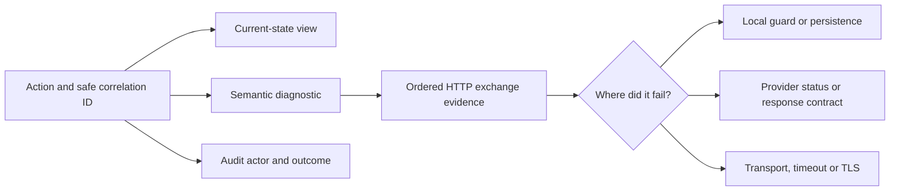
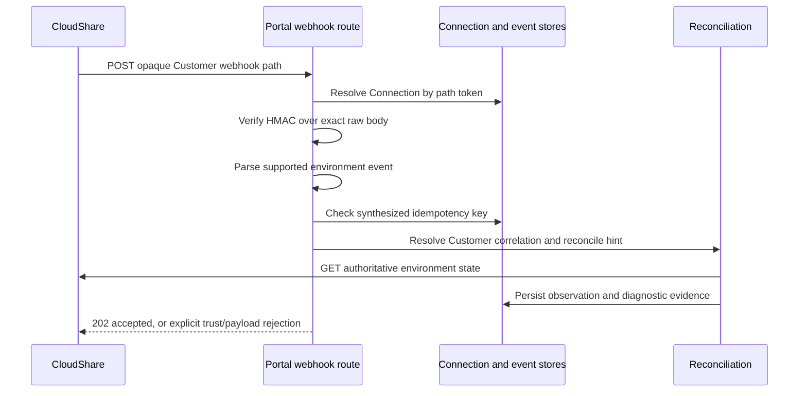

# Operations, monitoring and diagnostics

[Guide](README.md) · [Endpoint index](endpoints.md) · [Trial troubleshooting](sales-trial.md) · [Candidate troubleshooting](certification-candidate.md)

Use current-state monitoring to learn what is true now, audit records to learn who requested a change, and diagnostic exchanges to learn what the integration actually did. These answer different questions; a success audit does not prove a provider environment is currently ready.

## Find one action end to end

1. Record the persona, action, UTC timestamp and non-secret local identifier: `examAttemptId`, session ID, Offering ID or enrollment ID. Retain the displayed `correlationId` or durable command ID. Do not record a launch URL/token, session cookie or password.
2. For Certification open `/admin` Monitoring or the Candidate/attempt detail. `GET /api/admin/monitoring` combines local summaries/history with conditional completion/external-lease observation; `GET /api/admin/diagnostics/attempts/{examAttemptId}` joins the attempt's diagnostic context. For Sales open its session/participant workspace or Trial participant history first, then `/sales/diagnostics`.
3. Query the correct Customer-scoped diagnostic route: `GET /api/admin/diagnostics` for Certification, `GET /api/sales/diagnostics` for Sales. Supported filters include `from`, `to`, `source`, `operation`, `outcome`, `correlationId`, `subjectType`, `subjectId`, `integrationSurface`, `externalId`, `limit`, `offset`; Certification also supports `examId`, `examAttemptId`, `candidateEmail`. Dates should be explicit ISO timestamps such as `2026-10-30T10:00:00Z`. The session, never a query parameter, sets Customer scope.
4. Open the semantic operation and follow contributing exchange IDs to the HTTP evidence. A workflow correlation groups the action; an exchange ID identifies one provider attempt. Attempt-start sequence orders concurrent requests more reliably than completion time. OAuth acquisition can be shared: its acquisition evidence is separate from the intended resource request.
5. Compare requested operation, integration surface, method/path, returned HTTP status or transport/TLS/timeout failure, completed prior steps, and local persistence outcome. A 201 participant acknowledgement is different from a verified roster mapping; an accepted suspend/extend is different from observed state/expiry.
6. Consult `GET /api/admin/audit` for actor/action/outcome and `GET /api/admin/events` for integration/lifecycle event history. Audit filters include actor/action/subject/outcome and attempt/correlation identity. These are local reads, not fresh CloudShare observations. Retry only the workflow-supported safe recovery action; a missing response must not trigger blind duplicate provider writes.

Protected diagnostics are deliberately sensitive. Customer-scoped admin evidence retains request/query and provider-response bodies verbatim, including credential-bearing data; only an explicit operational request-header allowlist is preserved and other headers are masked. This exception does not authorize copying payloads into ordinary logs, screenshots, tickets or this guide. Candidate/client-safe errors and ordinary logs are redacted separately. RDP guest credentials are an intentional authenticated reveal, described in [Trial](sales-trial.md#optional-rdp-and-guest-credentials); that UI is not access to generic diagnostics.

Useful distinctions:

| Symptom | Evidence to inspect | Recovery boundary |
|---|---|---|
| Connection ping succeeds but authoring fails | `cloudshare.v3.ping` vs OAuth/v4 Project/Policy exchange | Correct credentials/permissions for failing surface; ping proves only its call. |
| Sales creation looks failed | Reservation, external/provider IDs, POST exchange and local save | Unknown creates require support correlation; verify route only works on a real active bound session. |
| Participant added but not launchable | Complete roster, exact custom properties, participant ID, participation and environment observation | Never infer identity solely from email or fabricate an environment ID. |
| Invitation says unconfirmed | Durable invitation command, capability GET, POST acknowledgement and roster readback | Reconcile retained command; do not send a new invitation to evade its fence. |
| Suspend/resume/extend times out | Command dispatch marker, provider acknowledgement, subsequent GETs | Observe target/expiry and settle; do not assume timeout means not applied. |
| End exam archived lab but shows error | Archive exchange vs completion persistence | UI-supported completion retry can save state; no second destructive dispatch is implied. |
| Webhook accepted but state unchanged | Trust gate, correlation, dedupe and reconciliation evidence | 202 acknowledges the hint, not state-transition success; polling remains authoritative. |

## Automatic work and request-triggered work

| Trigger | Frequency / ownership | What it can do |
|---|---|---|
| Browser session watchdog | Protected UI lifecycle | Local `GET /api/auth/session`; redirect on expiry. |
| Candidate heartbeat | Browser every 15 seconds while active | `POST /api/heartbeat`; local tracking and completion settlement; conditional provider work through lifecycle reconciliation. |
| Candidate status/home refresh | Lab status 15 seconds; home 30 seconds | Status/dashboard runtime reconciliation and safe view updates. Window check every three seconds only checks the child handle. |
| Missing-heartbeat sweep | Server check every 10 seconds; default missing interval 60 seconds (`HEARTBEAT_TIMEOUT_MS`) | Tracks observed heartbeats in process and invokes correlated suspend; not a durable distributed scheduler and not a CloudShare lease renewal. |
| Trial ending sweep | Server every five minutes | Reconcile `ending` Offerings, retained environments and conditional Sales End update. In-process overlap guard; per-Offering lease protects reconciliation ownership. |
| Explicit page/action requests | User read/refresh/enter/extend | Can reconcile completion, external expiry or ending even when background jobs are disabled. |
| Startup/seed composition | Configured server setup | Optional local seed import; runtime config is separate from demo seed data. |

`PORTAL_BACKGROUND_JOBS=disabled` stops the scheduled sweeps. It is **not a provider-write firewall**: explicit routes, browser polling and incoming webhooks can still run workflows. Fixture mode and a disposable database are appropriate for non-live demonstrations; do not claim fixture outcomes as live evidence.

## Webhook receipt and correlation

`POST /api/webhooks/cloudshare/{webhookPathToken}` is the inbound provider route. It resolves the Customer's Connection by opaque path token, checks `x-cloudshare-signature` as base64 HMAC-SHA256 of the **raw** body using that Customer's secret, then validates the payload. Supported events are environment created/suspended/resumed/deleted/extended/archived. Normalisation supports the documented `Event`, `CreatedAt`, `Payload` shape, including the stringified payload variant handled by the adapter.

The dedupe key is derived from environment identity, event type and provider timestamp, not a user-supplied Portal attempt ID. Customer correlation must be resolved before applying an observation. Duplicate/replayed/out-of-order hints cannot replace authoritative polling. Reconciliation reads v4 `GET /environments/{id}` through the environment source and records the resulting state; training participant reads are the separate assignment/correlation path.

Unknown path returns 404; missing/invalid signature 401; invalid supported payload 400. A validated event returns 202 even when reconciliation fails, with failure evidence retained. Unexpected handler failures return a deliberate 500. Automatic CloudShare webhook registration is not implemented as a verified operational flow here: register the configured receiver through the existing operator process. A working local tunnel or health check does not prove signed provider delivery.

`GET /api/health` is a local application/persistence readiness surface; it does not provision assets or certify provider reachability. Ordinary logs carry safe failure summaries; detailed Customer evidence belongs to admin diagnostics.

Sources: [diagnostic/event/audit handlers](../../src/api/admin.ts), [Sales diagnostic scope](../../src/api/sales-diagnostics.ts), [monitoring](../../src/api/admin-monitoring.ts), [attempt diagnostics](../../src/api/admin-exam-attempt-diagnostics.ts), [webhook handler](../../src/api/cloudshare-webhook.ts), [signature/normalisation](../../src/integrations/cloudshare/webhooks.ts), [receiver/dedupe](../../src/integrations/cloudshare/webhook-receiver.ts), [composition/sweeps](../../src/composition.ts), [heartbeat sweep](../../src/domain/heartbeat-auto-suspend.ts), [HTTP client](../../src/integrations/cloudshare/client.ts), [protected headers](../../src/observability/protected-request-headers.ts), [ADR-003](../decisions/ADR-003-event-correlation-and-polling-as-truth.md), [ADR-004](../decisions/ADR-004-typed-diagnostic-log-entry.md).
