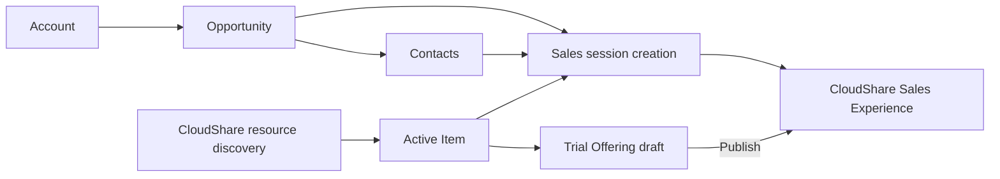

# Sales configuration, records and Items

[Guide](README.md) · [Sessions](sales-sessions.md) · [Trial Offerings](trial-administration.md) · [Connection/resource discovery](certification-admin.md)

A Certalis Sales Admin works in `/sales`. Accounts, Contacts and Opportunities describe a believable sales context and are stored only in Certalis. An Item captures a validated CloudShare configuration; a session or Offering later uses it to create an Experience.

## Local records and defaults

| Action order | Portal call | Inputs / persisted result / provider calls |
|---|---|---|
| 1. Browse hierarchy | `GET /api/sales/accounts` | Account/search context and local related records. Customer scoped; no CloudShare. |
| 2. Create Account | `POST /api/sales/accounts` | Validate name and local fields, persist Account. No provider call. |
| 3. Create Opportunity / Contact | `POST /api/sales/opportunities`; `POST /api/sales/contacts` | Validate parent IDs and Customer scope; persist local relationship and identity. No CRM or CloudShare write. |
| 4. Edit records | `PATCH /api/sales/accounts/{accountId}`, `/api/sales/opportunities/{opportunityId}`, `/api/sales/contacts/{contactId}` | Local validation and update. It does not rewrite an already provisioned Experience or existing participant identity automatically. |
| 5. Archive | `POST` each record's `/archive` route | Local archived/history state; no provider deletion. Unavailable/archived records cannot be treated as new active provisioning selections. |
| 6. Select Opportunity for session | `GET /api/sales/session-opportunities` | Local paginated account/Opportunity selection; query includes account and Opportunity search/page values and selected Opportunity. No provider call. |
| 7. Configure generated names | `GET`, then `PUT /api/sales/session-configuration` | Validate/save session-name `template` for the Customer; local only. Used at creation, not retroactive remote rename. |
| 8. Timezone choices/default | `GET /api/sales/timezones`, then optional `PUT` same route | GET can refresh/cache v3 `GET /timezones`; PUT persists the user's selected timezone locally. A valid cached timezone is part of provisioning validation. |
| 9. Sales Pro choices | `GET /api/sales/enablement-sessions/project-members?projectId={projectId}` | v3 `GET /users` scoped by the adapter's Project query and pagination. Validate eligible member identity instead of assuming the Portal admin email is a provider Sales Pro. |

Invalid input or cross-Customer references fail before writes. Archiving is not a way to cancel a live session: use the [session lifecycle](sales-sessions.md). The [complete route index](endpoints.md) lists each record route separately.

## Item authoring and control population

| Order | Browser → Portal | Internal/provider sequence |
|---|---|---|
| 1 | `GET /api/sales/items` and `GET /api/sales/items/{itemId}` | Local active/archived catalog or owned detail. |
| 2 | `GET /api/sales/item-authoring` | Reuse Customer authoring cache unless `refresh=true`; on refresh read v4 `GET /projects` (all pages), then v3 `GET /regions`. |
| 3 | `GET /api/sales/item-authoring/projects/{projectId}` | Read v3 `GET /projects/{projectId}/blueprints`; Blueprint details for available/default Snapshots; v4 `GET /projects/{projectId}/policies` and each `GET /projects/{projectId}/policies/{policyId}`. Controls derive valid Blueprint, default Snapshot, Region and Policy combinations. |
| 4 | `POST /api/sales/items` or `PUT /api/sales/items/{itemId}` | Read live Project pages, Regions, Project Blueprint list, selected Blueprint details, Policy list and Policy details in that order (detail batches may run together); validate the submitted Item and persist selected Project, Blueprints, Regions, Policy and duration. Resource reads are not Experience creation. PATCH is unsupported (405). |
| 5 | `POST /api/sales/items/{itemId}/archive` | Local history-only Item; blocked for new session provisioning. Existing provider objects are not deleted. |

The resource adapter deliberately mixes v4 Project/Policy reads with v3 Blueprint/Snapshot/Region reads. Policies supply runtime/storage evidence; Sales Item `defaultDurationMinutes` specifically derives from Policy storage lease, which must be present. This differs from Certification Exam time-limit semantics. Every selected Blueprint default Snapshot must share the chosen Regions. A stale cached form is insufficient authority at create/publish time. Partial resource errors preserve completed exchange evidence and reject invalid/incomplete configuration, rather than silently substituting another resource.

Diagnose authoring in `/sales/diagnostics`: filter `sales.item.authoring_resources.read`, Item ID if created, Project/resource type and correlation ID. Inspect whether failure was OAuth, the resource list, a detail lookup or tuple validation. A successful local record save need not have any CloudShare exchange; an Item save should have live validation evidence. Update the Connection or refresh resources, correct the tuple, then retry only the failed local operation.

Sources: [records](../../src/api/sales-records.ts), [records domain](../../src/domain/sales-records.ts), [Items](../../src/api/sales-items.ts), [authoring cache/workflow](../../src/api/admin-exam-authoring-runtime.ts), [resource adapter](../../src/integrations/cloudshare/resources.ts), [Item provisioning validation](../../src/integrations/cloudshare/sales-item-provisioning.ts), [timezones](../../src/api/sales-timezones.ts), [members](../../src/integrations/cloudshare/project-members.ts), [UI](../../src/web/sales-workspace.tsx).

Provider-contract caveat: implemented v3 `GET /users` (Project member discovery) and `PUT /envs/actions/archive` are absent from the bundled v3 export. See the [endpoint discrepancy record](endpoints.md#contract-and-implementation-discrepancies) and historical gap evidence; this guide does not claim new live verification.
