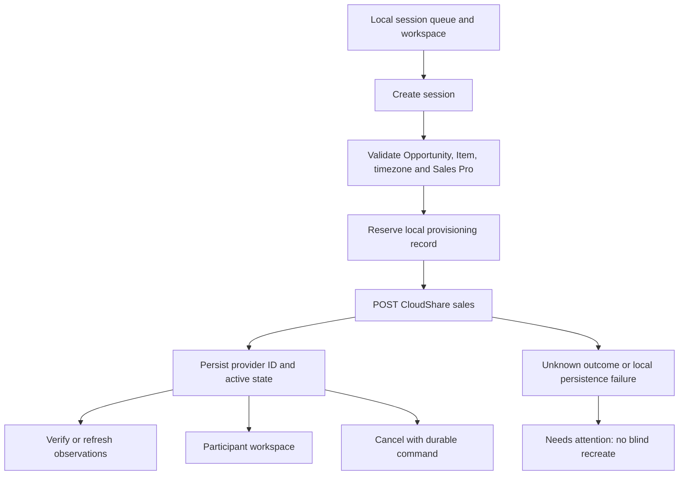
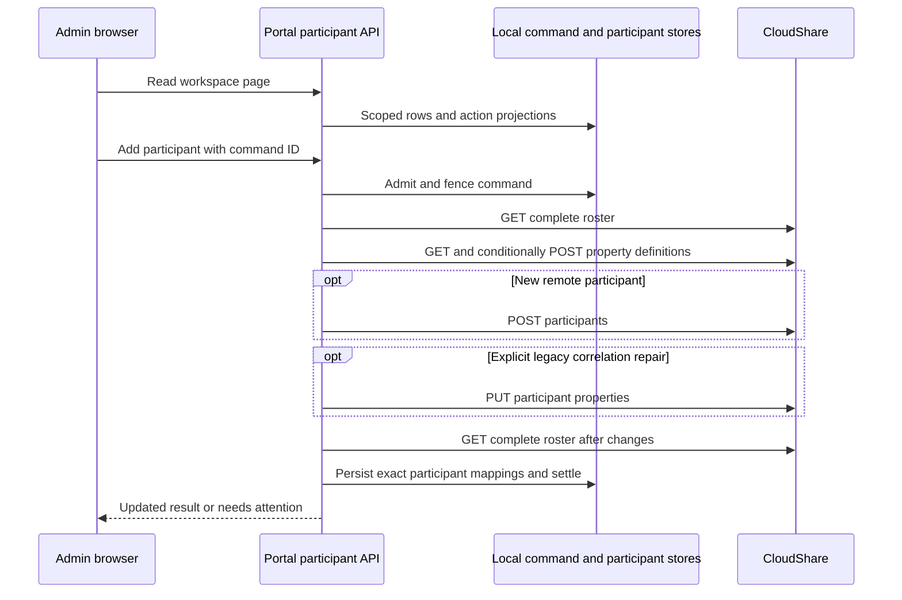

# Sales sessions and participants

[Guide](README.md) · [Records and configuration](sales-configuration.md) · [Trial lifecycle](trial-administration.md) · [Diagnostics](operations.md)

Sales Admins use `/sales` and `/sales/sessions/{sessionId}`. The UI calls these Enablement Sessions; the persistence and compatibility API retain `SalesDemoSession` / `demo-sessions` names. These are not Certification attempts or Trial Offerings.

## Read controls, provision, verify and cancel

Use `S = /api/sales/enablement-sessions/{sessionId}` below; the [index](endpoints.md) expands every path.

| Action / order | Portal call | Provider/local sequence and outcome |
|---|---|---|
| Queue | `GET /api/sales/enablement-sessions` | Local pagination/filtering and retained observations. `GET /api/sales/demo-sessions` retains the older list surface. No automatic create. |
| Detail | `GET S/workspace` | Local session context, current retained status and action availability; separate provider verification avoids making every render a remote write. |
| Populate creation form | [Configuration reads](sales-configuration.md) | Load local Opportunity/Item, naming template, timezone and provider Sales Pro choices before submit. |
| Create | `POST /api/sales/enablement-sessions` (also `POST /api/sales/demo-sessions`) | Validate owned active records, cached timezone and eligible Sales Pro; revalidate Item's Blueprint/Snapshot/Region/Policy resources; reserve local provisioning row with correlation/external ID; v4 `POST /sales`; persist returned Experience ID and `active`. Experience body includes type, Project, Blueprints, Regions, Policy, Opportunity, Sales Pro, start/end/timezone and registration settings. |
| Verify one | `POST S/verify` or `POST S/reconcile` | Only active sessions with a real provider ID. v4 `GET /sales/{id}`, validate exact identity and status (`notStarted`, `inProgress`, `ended`), persist observation source/time. No provider write and no repair of an unknown create outcome. |
| Refresh queue | `POST /api/sales/enablement-sessions/refresh` | Select targeted stale local sessions; paginated v4 `GET /sales?field=id=in(...)&offset=...&limit=100`; require complete target coverage; persist observations. Missing/duplicate coverage fails instead of marking absent sessions ended. |
| Edit | `PATCH S` | **Unavailable:** handler returns 409; controlled edits are deferred pending supported round-trip update contract. Do not infer editing support from the route's existence. |
| Cancel | `POST S/cancel` | Require a command ID. Read v4 Experience and complete participant roster; resolve exact retained environments where needed; admit durable cancellation command. A not-started Experience can use v4 `DELETE /sales/{id}`. Started cancellation archives applicable environments via v3 `PUT /envs/actions/archive?envId={id}`, verifies observations, then GET/PUT v4 `/sales/{id}` to set End/cancelled label, followed by GET readback and local settlement. |

A successful provider create followed by local-save failure is **not** safe to recreate. The retained external ID, provider ID when known, correlation ID and diagnostic exchanges are the recovery evidence. Verification reads an already bound active session; it is not a general duplicate-recovery command. Cancellation and extension use durable per-command states; reusing the same command supports readback, not repeated destructive dispatch after an unknown outcome. A failed archive or end update leaves explicit partial/needs-attention state.

## Participant workspace: reads, addition and invitation

| Action | Portal call | Ordered work / key state |
|---|---|---|
| Read/search | `GET S/participants` or `GET S/participants/page` | Local paginated participant/contact search and action projections. Includes invitation/command evidence and stale/fresh state; no invitation is sent by reading. |
| Explicit remote discovery | `GET S/participants/provider` | v4 `GET /sales/{id}/participants` over all pages; reconcile exact property/ID mappings and relevant v4 environment observations; retain local observations. |
| Refresh | `POST S/participants/refresh` | Refresh provider participant facts and retained command/invitation projections, then reread local workspace. Failed refresh preserves stale evidence and reports the failure. |
| Add | `POST S/participants/add` | Command ID plus existing Contact selection or ad hoc identity. Validate active session and Customer/Opportunity; create/reuse local Contact if needed. Read roster; ensure v4 `/sales/{id}/users/properties` definitions; register missing participants via POST `/sales/{id}/participants`; explicit legacy selections can PUT `/sales/{id}/participants/{participantId}` to backfill correlation; reread complete roster and persist exact mappings. |
| Reconcile uncertain add | `POST S/participants/add/reconcile` | Read command and evidence, then authoritative roster as needed. Proven pre-dispatch failure can become retryable; unresolved/ambiguous identity remains fenced. Do not issue a fresh add to evade the fence. |
| Invite/resend | `POST S/participants/invite` | Command ID and selected targets/revisions. Validate availability and claim durable invitation ledger; v4 `GET /sales/{id}` confirms invitation capability; read current roster, then `POST /sales/{id}/participants/invite` with provider participant IDs when eligible; readback/ledger settlement distinguishes sent, accepted-unconfirmed and failed-before-dispatch. Retained commands can reconcile without another send. |

Registration, invitation and participation are separate facts. A registered participant may not have been invited; an accepted invitation request does not prove email delivery or a running environment. Stale revisions, concluded participants, ended/cancelled sessions, native invitations disabled, incomplete roster and busy/uncertain commands can disable actions. Server guards remain authoritative even when the UI had previously enabled a button.

## Launch links

`POST S/participants/{participantId}/launch-link` generates a Certalis capability and stores only its hash; regeneration replaces the active capability. `DELETE` the same route revokes it. Both are local operations with audit/diagnostic evidence and lifecycle guards, **not** calls to CloudShare.

The recipient opens `GET /sales/launch/{token}` without a Portal participant login. The handler resolves the hash, revocation, owned session/participant/contact and access window, then calls v4 `POST /sales/{id}/sponsored-link`. It rechecks current local session cancellation before returning 302. Denial can resolve Sales Pro recovery contacts through paginated v4 `GET /sales/{id}/salespros`; the denial page stays safe. Do not copy either the capability token or provider login URL into tickets. A launch-link record is not an invitation delivery receipt.

## Extend participants

`POST S/participants/extend` takes a stable command ID and selected participants. In order: read Experience and complete roster; resolve each exact environment using v4 owner-email list plus detail and Item Project; persist command targets and before-expiry evidence; for eligible targets dispatch v4 `POST /environments/{id}/extend` once; read v4 `GET /environments/{id}` to confirm expiry; derive any required Experience access End; GET/PUT `/sales/{id}` preserving its mutable fields; GET readback; persist local End and per-target results. The 1–100 target bound and environment readiness/retention rules apply. Archived environments with retained work can be eligible even if participation concluded; do not equate `concluded` alone with deletion.

An ambiguous extension dispatch is reconciled through reads before another extension is permitted. Per-target success can coexist with a failed Experience-End update. Support must inspect both environment and Experience evidence rather than relying on one aggregate success label.

For diagnosis start with session ID, participant ID (if relevant), command ID and UTC time in `/sales/diagnostics`. Follow `sales.demo_session.*` operations and the correlation to individual exchanges. Compare session lifecycle, observed provider status/time, participant participation, invitation ledger and environment expiry separately. See [operations](operations.md) for safe evidence handling.

Sources: [create](../../src/api/sales-demo-sessions.ts), [queue](../../src/api/sales-session-queue.ts), [refresh](../../src/api/sales-session-refresh.ts), [verify](../../src/api/sales-session-reconciliation.ts), [deferred edit](../../src/api/sales-session-edit.ts), [cancel](../../src/api/sales-demo-session-cancellation.ts), [participant application](../../src/application/sales-session-participants.ts), [workspace domain](../../src/domain/sales-participant-workspace.ts), [launch](../../src/api/sales-participant-launch.ts), [extension](../../src/api/sales-participant-extension.ts), [provider adapter](../../src/integrations/cloudshare/sales-delivery.ts).

Provider-contract caveat: implemented v3 `GET /users` (Project member discovery) and `PUT /envs/actions/archive` are absent from the bundled v3 export. See the [endpoint discrepancy record](endpoints.md#contract-and-implementation-discrepancies) and historical gap evidence; this guide does not claim new live verification.
