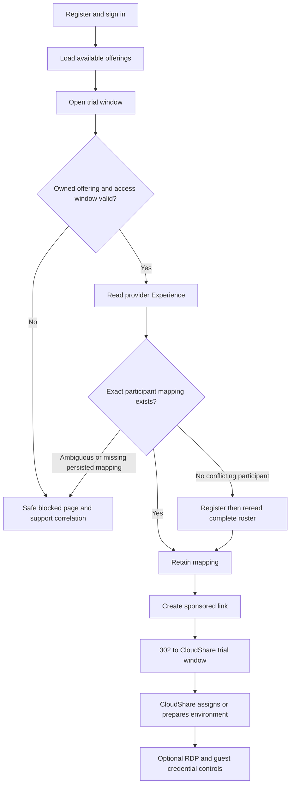
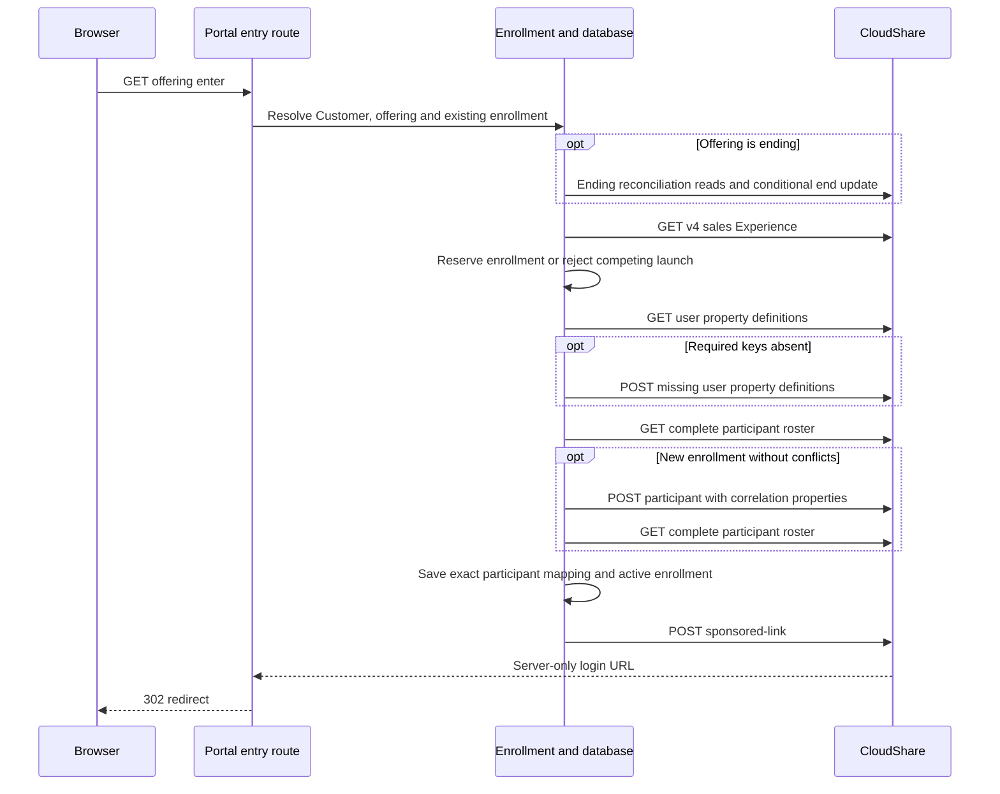

# Sales Trial: from registration to a running lab

[Guide](README.md) · [Admin setup](trial-administration.md) · [Authentication](authentication.md) · [Support](operations.md)

A Sales Trial participant starts at `/sales-trial/register` or `/sales-trial/login`, then `/sales-trial`. The Customer must already have a published Trial Offering backed by a CloudShare Sales Experience. Registering a portal account does not register a CloudShare participant or provision an environment.

## Account and offering selection

| Order | Caller → Portal / local action | Inputs, result and provider work |
|---|---|---|
| 1 | Browser `POST /api/sales-trial/register` | First/last name, email, password. Normalise email, validate names, resolve the configured Sales registration Customer, reject duplicate account, hash password and persist `sales_trial_participant`. **No CloudShare call.** Registration returns 201; sign in is separate. |
| 2 | Browser `POST /api/sales-trial/login` | Verify password against that Customer and role; persist session and set cookie. Failure is a generic credential error. **No CloudShare call.** Shared `/api/auth/login` also routes established users by role. |
| 3 | Page data / `GET /api/sales-trial/offerings` | Local published offerings within their wall-clock window; also qualifying unpublished/ending offerings with this user's continuable enrollment. Return display fields, not provider credentials. **No CloudShare call in listing.** |
| 4 | Browser opens `GET /sales-trial/offerings/{offeringId}/enter` | Named window per offering. An already open window is focused, without repeating entry. Popup denial appears on the home page. Entry independently validates the cookie/role/Customer; a visible card is not authority. |

Start is inclusive, end exclusive, interpreted in the Offering's stored CloudShare timezone; an explicitly open-ended Offering has `end: null`. A participant cannot supply a Customer or another person's enrollment to bypass these checks.

## The entry request, exactly in order

| Step | Exact operation | Purpose, state and branch |
|---|---|---|
| 1 | Local offering/enrollment lookup; conditional [ending reconciliation](trial-administration.md#end-and-retained-environments) | `published` requires an open window. `unpublished`/`ending` permits only retained continuable access. Missing Experience/Connection is denied. |
| 2 | v4 `GET /sales/{salesExperienceId}` | Require `inProgress`, or `ended` only for continued access; provider End must match the stored End after timezone normalisation. |
| 3 | Local reservation | One enrollment for Offering + portal user; `provisioning` without a bound participant blocks a concurrent launch. `needs_attention` is fail-closed. IDs are allocated before provider registration. |
| 4 | v4 `GET /sales/{id}/users/properties`; conditional `POST` same path | Ensure `certalisSalesTrialEnrollmentId` and `certalisSalesTrialParticipantUserId`. POST only missing definitions, then validate returned definitions. |
| 5 | v4 `GET /sales/{id}/participants?offset=0&limit=100` and subsequent pages | Require a complete roster. Match both custom properties and the retained participant ID. Never silently adopt a same-email or propertyless participant. |
| 6 | Conditional v4 `POST /sales/{id}/participants`, then paginated `GET` roster | Body is an array containing normalised identity and both properties. A registration acknowledgement does not establish identity: exactly one correlated participant must exist in the readback with no same-email conflict. Existing exact mappings skip POST. |
| 7 | Local enrollment save | Persist provider participant ID, participation/environment observations, `active`, and launch timestamp. Provider environment creation is not performed by a separate Portal create-environment call here. |
| 8 | v4 `POST /sales/{id}/sponsored-link` | Send participant identity and `preRegisteredStudent: false`. Return the resulting URL only as the entry route's 302 destination. Record workflow/HTTP evidence under the enrollment correlation. |
| 9 | Browser follows redirect | CloudShare handles its landing/console and environment preparation. The Portal does not claim the environment is ready merely because registration or redirect succeeded. |

The Portal uses a **separate CloudShare trial window**, not an iframe console hosted by Certalis. The home card embeds the optional remote-desktop controls described below. The blocked window can send a same-origin, offering-matched failure message to the opener; session expiry returns the user to sign in.

## Subsequent visits and failure recovery

An existing exact enrollment is rechecked against the live Experience and complete roster before a new sponsored link is generated. Missing persisted participant, duplicate correlation, an unbound correlated participant, or a same-email conflict fails closed; the handler records `needs_attention` for correlation ambiguity. Other provider failures can record `retryable_failure`; a retry still runs the full guards and cannot safely mean 'register another participant'. A still-running reservation is not a second launch opportunity.

An unpublished Offering closes admission but can remain accessible to an existing participant with a retained environment. Ending reconciles those retained environments; it is not a blanket immediate deletion. Once access or environment eligibility fails, entry/RDP is unavailable. An expired or concluded environment is not recreated automatically. Ask the Sales Admin to inspect the enrollment and [extension/end state](trial-administration.md), rather than repeatedly registering new accounts.

## Optional RDP and guest credentials

After opening the trial, the card can check remote-desktop availability. Each request repeats authorization and current provider checks; an opaque VM selector is a reference, never permission.

| Order | Portal request and downstream calls | Result / enablement |
|---|---|---|
| 1 | `GET /api/sales-trial/offerings/{offeringId}/rdp` | Require this user's active enrollment, prior launch, bound participant, eligible Offering and Connection/Item. |
| 2 | v4 `GET /sales/{id}`, then paginated `GET /sales/{id}/participants` | Exactly one correlated participant with the stored ID/email; reject conflicts and `concluded`. `pending` or no environment reports preparing. |
| 3 | v4 `GET /environments?OwnerEmail={email}&Count=true&Offset={offset}&Limit=100`, then v4 `GET /environments/{id}` through environment observation | Resolve exactly one canonical environment within the Item Project; require ready and a future Trial expiry. No environment is created by this request. |
| 4 | v4 `GET /environments/{id}/vms?Count=true&Offset={offset}&Limit=100` | List Windows VMs only. Ready requires known public RDP configuration and provider readiness. Response exposes opaque selectors, names and availability, not provider IDs or credentials. |
| 5a | `GET /api/sales-trial/offerings/{offeringId}/rdp/{selector}`; repeat steps 1–4; v4 `GET /environments/{id}/vms/{vmId}`, then v3 `GET /vms/actions/getremoteaccessfile?vmId={vmId}&desktopWidth=1920&desktopHeight=1080` | Revalidate selected VM and return provider RDP file as a download. **Connection reachability is not verified.** |
| 5b | `POST /api/sales-trial/offerings/{offeringId}/rdp/{selector}/credentials`; repeat steps 1–4; v4 `GET /environments/{id}/vms/{vmId}` | Same-origin, explicit reveal of guest username/password for the selected VM. Other HTTP methods return 405. Credentials intentionally appear in this authenticated UI, unlike the sponsored login URL. |

The credential panel clears its displayed values on hide/dismiss; copied clipboard content remains until replaced. Treat downloaded files and copied credentials as access material. No Windows machine, disabled/unknown public RDP, preparing VM, expired Trial or provider failure leaves the trial window as the alternative; it does not trigger provisioning or a fallback provider write. Errors return safe static text, with detailed exchange evidence restricted to Customer admin diagnostics.

For diagnosis, record the Offering ID and UTC action time, then ask the Sales Admin to open `/sales/diagnostics`, find `sales_trial.offering` / `sales_trial.rdp` operations and follow the enrollment subject and `correlationId`. Check the first failed exchange: Experience, properties, roster completeness/correlation, sponsored link, environment, VM detail or v3 RDP file. A successful register plus failed sponsored link is a partial success, not evidence that registration should be repeated.

Sources: [home and controls](../../src/web/sales-trial-home.tsx), [window lifecycle](../../src/web/sales-trial-window.ts), [account handlers](../../src/api/sales-trial-portal.ts), [Offering list](../../src/api/sales-trial-offerings.ts), [entry orchestration](../../src/api/sales-trial-enrollment.ts), [RDP orchestration](../../src/api/sales-trial-rdp.ts), [RDP HTTP guards](../../src/api/sales-trial-rdp-http.ts), [RDP adapter](../../src/integrations/cloudshare/trial-rdp.ts), [Sales delivery](../../src/integrations/cloudshare/sales-delivery.ts).

RDP evidence limit: VM FQDN/public-RDP eligibility follows tenant-observed signals (GAP-36), not a general OpenAPI connectivity guarantee; see the [contract discrepancy record](endpoints.md#contract-and-implementation-discrepancies).
