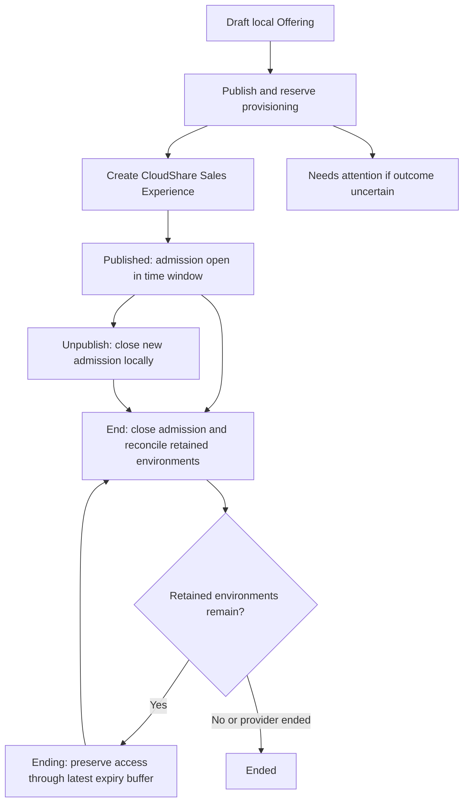

# Trial Offering administration

[Guide](README.md) · [Participant walkthrough](sales-trial.md) · [Items](sales-configuration.md) · [Diagnostics](operations.md)

Sales Admins use `/sales/trial-offerings`. An Offering is a reusable invitation to self-register for a Trial, backed by one CloudShare Sales Experience. Publishing creates that Experience; a participant's later entry registers the person and obtains a sponsored link.

## Create and publish

| Order | Portal operation | Local / provider work |
|---|---|---|
| 1 | `GET /api/sales/trial-offerings` | Customer-scoped local draft/published/history list and attention state. Populate Item, timezone and Sales Pro choices through [configuration reads](sales-configuration.md). |
| 2 | `POST /api/sales/trial-offerings` | Validate title, description, active Item, wall-clock start/end, timezone and Sales Pro email. `end: null` requires explicit `noEndDate`. Save `draft`, no provider ID. **No CloudShare call.** |
| 3 | `POST /api/sales/trial-offerings/{id}/publish` | Validate state and stored inputs; require Connection, eligible provider Sales Pro and valid timezone; revalidate live Item resources. Reserve publication before dispatch to prevent duplicate creates. |
| 4 | v4 `POST /sales` | Create Trial Experience with the Item tuple, start/end/timezone, registration and Sales Pro settings, and generated correlation/external ID. Store returned provider ID and `published`. The session is created here, not at account registration. |
| 5 | Local publication result | Known pre-dispatch failures can release reservation; ambiguous remote create or local-save failure retains correlation and `needs_attention`. Do not unpublish/recreate to erase the evidence. |

Publish validates the current resource tuple, including v3 Blueprint details/default Snapshots and v4 Policy reads; the [resource chapter](sales-configuration.md#item-authoring-and-control-population) supplies exact paths. No customer-specific IDs are defaults in this guide. Republish/recovery is constrained by retained provider correlation, not a promise that every non-published state can safely POST another Experience.

## Unpublish, monitor and extend

| Action | Portal call | Ordered work and limits |
|---|---|---|
| Close new admission | `POST /api/sales/trial-offerings/{id}/unpublish` | Only a published Offering changes to local `unpublished`. **No CloudShare call.** Existing qualifying enrollments can continue. Provisioning/needs-attention states are blocked to preserve correlation. |
| Participant history/current facts | `GET /api/sales/trial-offerings/{id}/participants` | If ending, first reconcile ending; load enrollments and v4 paginated `/sales/{id}/participants`; require complete roster, reconcile exact IDs/properties and environment observations. Return source/freshness and extend eligibility. Provider failure can preserve retained rows with stale warning. |
| Extend one participant | `POST /api/sales/trial-offerings/{id}/participants/{participantId}/extend` | Here `participantId` identifies the local enrollment. Validate active ownership, bound environment and eligible lifecycle; reserve extension; v4 owner-email environment list/detail resolves exact Project environment; persist pending evidence; `POST /environments/{id}/extend`; `GET /environments/{id}` confirms changed expiry; save active observation or `needs_attention`. |

An unconfirmed previous extension must reconcile from current provider state before another dispatch. Roster numeric environment metadata is not assumed to be the canonical opaque environment ID. The Item Project and owner-email resolution must establish one environment. Participant enrollment state, participation state, environment state and Offering state are separate dimensions.

## End and retained environments

`POST /api/sales/trial-offerings/{id}/end` claims the ending reconciliation lease and stops new admission. The configured runtime path uses the environment-aware ending workflow:

1. Read v4 `GET /sales/{id}` and the complete paginated `GET /sales/{id}/participants` (these reads can run together).
2. If the provider already reports ended, persist `ended`. Otherwise resolve the Item and each roster participant with an assigned environment through v4 `GET /environments?OwnerEmail=...&Count=true&Offset=...&Limit=100` and `GET /environments/{id}`, constrained to the Item Project. Duplicate/unknown identity or invalid expiry stops reconciliation.
3. Treat all observed environments except `deleted` and `creation_failed` as retained. Compute End as latest Trial expiry plus **five minutes**, rounded upward to minute precision. With no retained environments, set a persisted terminal target of now plus **two minutes**, also rounded upward; do not keep moving this target on each pass.
4. If the calculated end requires change, the Sales adapter first GETs `/sales/{id}`, validates/preserves the full documented mutable fields, then PUTs `/sales/{id}` with changed End. An already later safe provider End is preserved while environments remain.
5. Save `ending` with calculated/effective End and reconciliation timestamp, or `ended` when no retained environments remain. A failed/uncertain update keeps attention evidence and admission closed; a later reconciliation reads again rather than blindly repeating a create.

Background reconciliation runs every five minutes when background jobs are enabled. Participant enter, monitoring and extension paths can also reconcile an `ending` Offering; disabling background jobs does not disable these request-triggered actions. End does **not** dispatch archive/delete for each retained Trial environment. Existing continuable access is described in [participant entry](sales-trial.md).

Diagnose in `/sales/diagnostics` using Offering ID, enrollment ID and action correlation. For publish inspect resource validation, reservation, create acknowledgement and local persistence separately. For end inspect complete roster, canonical environment IDs, each Trial expiry, calculated End, current provider End, lease/attention reason and last reconciliation time. For extension inspect before/after expiry and whether dispatch already happened. Never recover an uncertain command by changing identity or replaying raw provider writes.

Sources: [Offering handlers](../../src/api/sales-trial-offerings.ts), [enrollment/monitoring/extension](../../src/api/sales-trial-enrollment.ts), [ending calculation](../../src/domain/sales-trial-ending.ts), [background runner](../../src/api/sales-trial-ending-reconciliation.ts), [composition](../../src/composition.ts), [admin UI](../../src/web/sales-trial-offerings-admin.tsx), [Sales adapter](../../src/integrations/cloudshare/sales-delivery.ts).
